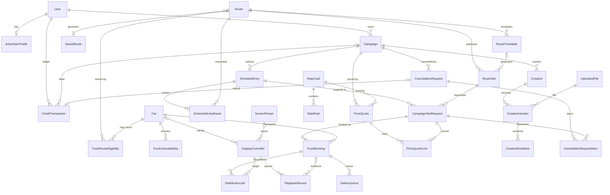

# Proposed entities

This document lists the database entities the backend needs to cover the
product described in [`BUSINESS_PLAN.md`](../BUSINESS_PLAN.md), and the changes
the existing Prisma models need. It is a proposal, not an applied schema:
nothing here exists in `prisma/schema.prisma` unless the section
[What exists today](#what-exists-today) or the implemented first migration in
[User and roles](#user-and-roles) says so.

References in brackets point at the business plan: `§n` is a section, `C-xx` a
confirmed feature, `AC-xx` an acceptance scenario and `O-xx` an open question.
An entity or field that depends on an open question says so; don't treat its
shape as decided until the question is answered.

When implementing, follow the schema-change procedure in [`AGENTS.md`](AGENTS.md)
(named migration with `--create-only`, review the SQL, apply, `prisma:generate`,
`typecheck`), one milestone at a time.

## Contents

1. [Conventions](#conventions)
2. [What exists today](#what-exists-today)
3. [User and roles](#user-and-roles), [Plan records → entities](#plan-records--entities)
4. [Entity map](#entity-map)
5. [M1 — Accounts, fleet and inventory](#m1--accounts-fleet-and-inventory)
6. [M2 — Credits and payments](#m2--credits-and-payments)
7. [M3 — Campaign requests, pricing and content](#m3--campaign-requests-pricing-and-content)
8. [M4 — Review and confirmation](#m4--review-and-confirmation)
9. [M5 — Controller execution and reporting](#m5--controller-execution-and-reporting)
10. [M6 — Cancellations and delivery exceptions](#m6--cancellations-and-delivery-exceptions)
11. [Changes to existing models](#changes-to-existing-models)
12. [Database-level guarantees](#database-level-guarantees)
13. [Deferred and decision-dependent](#deferred-and-decision-dependent)
14. [Implementation order](#implementation-order)

## Conventions

These follow the current schema so new models look like the existing ones.

- **IDs:** `String @id @default(dbgenerated("gen_random_uuid()")) @db.Uuid`.
- **Instants:** `DateTime @db.Timestamptz(3)`. Concrete slots, bookings,
  unavailability and playback use real instants.
- **Client schedule choices:** a Europe/Bucharest local date (`YYYY-MM-DD`) plus
  minutes from local midnight, exactly as `src/lib/campaign-validation.ts` does
  today. Never use UTC midnight as the scheduling day. Expanding a local choice
  into instants happens in one place, so DST handling (O-06) is decided once.
- **Optimistic locking:** admin-edited rows carry `version Int @default(1)`;
  updates match and increment it, and stale edits return 409.
- **Credits:** whole credits are `Int`, like `User.creditBalance` and
  `CreditTransaction.amount`. Intermediate pricing amounts are
  `Decimal(14, 4)` and are rounded once, by the rule O-08 fixes.
- **Money:** minor units (`Int`) plus a `Char(3)` currency, like `CreditPurchase`.
- **Financial and audit rows survive account deletion:** user references on
  them use `onDelete: SetNull`, as `CreditPurchase` and `CreditTransaction` do.
- **Ledgers are append-only:** corrections are new rows, never edits.
- **Constraints Prisma can't express** (CHECK, partial unique, exclusion) go in
  the migration SQL by hand, as the credits migration already does, and must be
  kept by later migrations.
- **Enums** are Prisma schema enums (allowed under `erasableSyntaxOnly`).

## What exists today

| Model | What it covers | Gap against the plan |
| --- | --- | --- |
| `User`, `Role` | Identity, roles (ADMIN, OPERATOR, DRIVER, USER), session versioning, account status, name/phone and account timestamps. `USER` is the advertiser. | Shared role validity remains unchanged; no organisation data (O-19). Advertisers own files and credits, not campaigns yet. |
| `UserAvatar` | Profile picture. | — |
| `UploadedFile` | Stored uploads (JPEG, PNG, WebP, MP4) with owner. | No link to campaigns or review state; deleting is unconditional. |
| `CreditPurchase` | Request to buy credits; admin-confirmed today, card processor later. | No processor event inbox (AC-07). |
| `CreditTransaction` | Append-only ledger; types `PURCHASE`, `ADJUSTMENT`, `CAMPAIGN_DEBIT`, `REFUND`. | `CAMPAIGN_DEBIT` and `REFUND` have nothing to point at, so "one debit per campaign" can't be enforced. |
| `Car` | Fleet inventory: plate, make/model, driver name text, `CarStatus`, `routeId` as a fixed `CarRoute` label. | Route is a label, not a bookable route; no eligibility, unavailability periods or controllers. |
| `Campaign` | Admin-only draft: `name`, `days` JSON of local dates and minute intervals. | No owner, status, routes, truck counts, recurrence, price or content. |
| `SavedRoute` | Map stops for the route builder. | Not tied to anything bookable. |
| `ScreenPreset` | Controller canvas size and three screen regions for conversion. | Not tied to a truck or controller. |

## User and roles

The first `user_account_hardening` migration is deliberately independent of
O-19 (advertiser onboarding and company membership) and O-23 (driver operations).
The remaining items below are proposals, not part of that migration.

### First migration: account identity and access

| Field / constraint | Type / behavior |
| --- | --- |
| `createdAt`, `updatedAt` | `Timestamptz(3)`, creation defaults to now and updates use Prisma `@updatedAt`. Existing rows receive the migration time; their original creation time is unknown. |
| `createdById` | Nullable UUID self-reference, `SetNull`, indexed. Admin-created users record the actor; historical and locally bootstrapped accounts have no known creator. |
| `status` | `UserStatus`: `ACTIVE` (default) or `DISABLED`. Independent of the shared role. |
| `disabledAt` | Nullable `Timestamptz(3)`, set on disabling and cleared on reactivation. |
| `lastLoginAt` | Nullable `Timestamptz(3)`, recorded only after successful authentication. |
| `passwordChangedAt` | Nullable `Timestamptz(3)`, set when a password is first assigned or changed; unknown for historical rows. |
| `displayName` | `VarChar(200)`, default empty string for existing accounts and callers omitting a name. |
| `phone` | Nullable `VarChar(32)`; API accepts international E.164 notation (`+`, nonzero country code, up to 15 digits). |
| `email` | Unique `VarChar(254)` with `CHECK (email = lower(email))`. Preflight existing values before narrowing; do not silently truncate, lowercase or merge conflicting accounts. |
| `sessionVersion` | Preserve token revocation and add `CHECK (sessionVersion >= 0)`. |

Disabled accounts cannot log in or use an existing token. Email, password,
role and status changes increment `sessionVersion`; re-enabling never restores
old tokens. Name/phone edits leave sessions valid. Administrators cannot disable
themselves, and removing, demoting or disabling the last active administrator
is refused within the existing serializable transaction.

The public user contract adds `displayName`, `phone`, `status`, `createdAt` and
`lastLoginAt`, including the admin list, login/profile and avatar responses so
clients can use one consistent decoder. Creation provenance, password timestamps,
hashes and session versions stay private. The Users form edits name, phone and
status; its table shows those fields and account activity dates.

### Role validity: decision still open

`Role` is a shared lookup with one row per name. Its `startDate`, `endDate` and
`activ` affect all users of that role together. Only administrator authorization
checks `isRoleValid`; an inactive/expired USER, DRIVER or OPERATOR role currently
does not block login or ordinary profile access. Public responses expose only
the role name. `activ` also mixes Romanian naming into an English schema.

Decide whether validity belongs on `User` (`roleValidFrom`, `roleValidUntil`),
whether account `status` alone covers the requirement, or whether a person may
hold multiple roles through `UserRole(userId, roleName, validFrom, validUntil)`.
After that decision, simplify `Role` to a lookup or put `RoleName` directly on
`User`. No role dates, flags or authorization semantics move in this migration.

### Remaining common account fields

| Proposal | Purpose / dependency |
| --- | --- |
| `disabledReason Text?` | Explain suspension; not in the first migration. |
| `mustChangePassword Boolean` default false | Force a change after an admin supplies credentials. Requires a password-change flow and restricted first-login session. |
| `failedLoginCount Int` default 0, `lockedUntil Timestamptz(3)?` | Persistent account-level throttling in addition to the current per-IP, in-memory limiter. Define unlock and abuse-prevention behavior first. |
| `locale VarChar(8)` default `ro` | Notification language (O-24). |
| Rename `password` to `passwordHash` | Optional naming improvement; the existing column already contains only Argon2id hashes. |

### Advertisers and company ownership (O-19 — undecided)

One login per company versus several employees sharing a company is **undecided**.
The provisional 1:1 `AdvertiserProfile` cannot share campaigns or credits between
employees. If that is required, introduce `Organization` and
`OrganizationMember(userId, orgId, memberRole)`, and move balances and campaign
ownership to the organisation before those relationships become established.
Neither model is introduced by the first migration.

Expand the provisional billing profile with `legalType` (`COMPANY`, `INDIVIDUAL`),
`vatPayer Boolean`, `billingEmail`, and structured `street`, `city`, `county`,
`postalCode`, `country Char(2)` instead of one address blob. Make non-null `taxId`
unique only once company identity and membership are settled. Do not collect a
personal CNP without a confirmed invoicing requirement. Confirm required fields
and retention with the invoicing integration; this is not a legal specification.

Snapshot billing identity on each `CreditPurchase` as `billingSnapshot Json` once
the billing model is decided. Currently hard deletion nulls financial user
references and loses client identity; disabling retains the account and its
relationships. Prefer disable/anonymise workflows for financial accounts, with
an explicit retention policy. The first migration adds disabling but does not
change the existing hard-delete endpoint or implement financial snapshots.

If O-19 chooses self-registration, define versioned terms/privacy acknowledgements
(`termsAcceptedAt`, `termsVersion`, `privacyAcceptedAt`) and optional
`marketingConsentAt` separately. Invitations and an `INVITED` state also depend
on that onboarding decision; neither is added now.

### Role-specific gaps

- **DRIVER (O-23):** `Car.driverName` is free text. Choose a nullable `driverId`
  reference (`SetNull`) or dated `DriverAssignment(carId, driverId, startsAt,
  endsAt)`. A future 1:1 `DriverProfile` could hold `licenseNumber`,
  `licenseCategories Text[]`, `licenseExpiresAt`, `employeeCode` and an optional
  emergency contact, subject to the operational requirements.
- **DRIVER sessions:** one-hour tokens have no refresh flow; native HDMI playback
  enforces expiry. A future rotating, hashed `RefreshToken` store (`userId`,
  `tokenHash`, `deviceName`, `expiresAt`, `revokedAt`, `lastUsedAt`) should support
  long shifts and per-device revocation. No session duration changes here.
- **OPERATOR:** common name/phone cover the immediate contact need. Regional or
  route scope waits for the operational route model in M1.
- **ADMIN:** propose MFA using `mfaSecretEncrypted`, `mfaEnabledAt` and separately
  hashed recovery codes, with enrolment and recovery flows. Deferred.

### Supporting account tables (deferred)

| Table | Purpose / dependency |
| --- | --- |
| `PasswordResetToken(userId, tokenHash, expiresAt, usedAt)` | Self-service password recovery; today an admin resets passwords. |
| `UserInvitation(email, role, tokenHash, invitedById, expiresAt, acceptedAt)` | Invite onboarding, if selected by O-19. |
| `RefreshToken` | Mobile session renewal and per-device sign-out. |
| `AuditEvent` | Include account creation, role changes, disables/reactivations and administrator password resets; never store credential values. |

## Plan records → entities

How each conceptual record in §13.2 maps onto existing and proposed entities.

| Plan record (§13.2) | Entities |
| --- | --- |
| Client / account | `User` (existing), `AdvertiserProfile` |
| Truck and controller/screen association | `Car` (existing), `DisplayController`, `ScreenPreset` (existing) |
| Route and published route slot | `Route`, `RouteTimetable`, `RouteSlot`, `SavedRoute` (existing, geometry only) |
| Unavailability period | `TruckUnavailability` |
| Campaign | `Campaign` (changed) |
| Schedule entry and instance | `ScheduleEntry`, `ScheduleEntryRoute`; instances are `CampaignSlotRequest` rows grouped by `occurrenceDate` |
| Campaign request for a route slot | `CampaignSlotRequest` |
| Truck booking | `TruckBooking` |
| Pricing rule and saved price calculation | `RateCard`, `RateRule`, `PriceQuote`, `PriceQuoteLine` |
| Credit account and transaction | `User.creditBalance`, `CreditTransaction` (both existing; the latter changed) |
| Credit purchase | `CreditPurchase` (existing), `PaymentEvent`, `CreditPackage` (optional) |
| Creative and approval | `Creative`, `CreativeVersion`, `CreativeRendition` |
| Distribution task | `DistributionJob` |
| Playback record | `PlaybackRecord` |
| Cancellation request | `CancellationRequest`, `CancellationRequestItem` |
| (§12.4 delivery exceptions) | `DeliveryIssue`, `TruckBooking.deliveryStatus` |
| (§16.1 audit history) | `AuditEvent` |

## Entity map

Existing models are included where new ones attach to them. `AuditEvent`,
`PaymentEvent` and `CreditPackage` are left out to keep the diagram readable.

## M1 — Accounts, fleet and inventory

### `AdvertiserProfile`

Organisation data for an advertiser account. One row per `USER` who needs it.
Ownership of campaigns and credits stays on `User`; this only adds the company
details (§13.2 "Client/cont", US-01). Fields are provisional until O-19 decides
how advertisers are onboarded and what company data is required.

| Field | Type | Notes |
| --- | --- | --- |
| `userId` | `Uuid` PK, FK → `User` | `onDelete: Cascade`. |
| `companyName` | `VarChar(200)` | |
| `taxId` | `VarChar(32)?` | Fiscal code. |
| `tradeRegisterNo` | `VarChar(64)?` | |
| `billingAddress` | `Text?` | |
| `contactName` | `VarChar(200)?` | |
| `contactPhone` | `VarChar(32)?` | |
| `createdAt`, `updatedAt` | `Timestamptz(3)` | |

### `Route`

A predefined operational route the company offers (§6.1, C-03, Q-10). Replaces
the `CarRoute` label enum on `Car`.

| Field | Type | Notes |
| --- | --- | --- |
| `id` | `Uuid` PK | |
| `code` | `VarChar(32)` unique | Short stable identifier shown to admins. |
| `name` | `VarChar(200)` | |
| `description` | `Text` | Default `""`. Shown to advertisers. |
| `timezone` | `VarChar(64)` | Default `Europe/Bucharest` (§6.2 rule 3). |
| `savedRouteId` | `Uuid?` FK → `SavedRoute` | Map geometry; `onDelete: SetNull`. Optional. |
| `active` | `Boolean` | Inactive routes accept no new requests; existing bookings stay. |
| `version` | `Int` | |
| `createdAt`, `updatedAt` | `Timestamptz(3)` | |

### `RouteTimetable`

An admin template that generates `RouteSlot` rows, for example "weekdays
16:30–18:00, 4 trucks". It exists so admins don't publish every slot by hand.
Advertisers never book a timetable, only the slots it produced.

| Field | Type | Notes |
| --- | --- | --- |
| `id` | `Uuid` PK | |
| `routeId` | FK → `Route` | `onDelete: Cascade`. |
| `weekdays` | `Int[]` | ISO weekdays, 1 = Monday … 7 = Sunday. Non-empty. |
| `startMinute`, `endMinute` | `Int` | Local minutes, `0 ≤ start < end ≤ 1440`, multiples of 15. Slots past midnight wait on O-06. |
| `capacity` | `Int` | Default capacity for generated slots, `> 0`. |
| `effectiveFrom` | `Date` | Local date. |
| `effectiveTo` | `Date?` | Inclusive; null means open-ended. |
| `version` | `Int` | |
| `createdAt`, `updatedAt` | `Timestamptz(3)` | |

Changing a timetable never moves or deletes slots that already have requests
or bookings (§6.2 rule 9, §6.4). It only affects slots it hasn't generated yet.

### `RouteSlot`

A published, concrete, bookable run of a route: the plan's "interval
rezervabil al traseului" (§6.1). This is the unit advertisers request and the
unit pricing and bookings attach to.

| Field | Type | Notes |
| --- | --- | --- |
| `id` | `Uuid` PK | |
| `routeId` | FK → `Route` | `onDelete: Restrict`. |
| `timetableId` | `Uuid?` FK → `RouteTimetable` | `onDelete: SetNull`; null for hand-published slots. |
| `startsAt`, `endsAt` | `Timestamptz(3)` | CHECK `endsAt > startsAt`. |
| `capacity` | `Int` | Maximum trucks sold on this slot, `> 0`. |
| `status` | `RouteSlotStatus` | `PUBLISHED`, `WITHDRAWN`. |
| `createdAt`, `updatedAt` | `Timestamptz(3)` | |

Unique `(routeId, startsAt)` so regenerating from a timetable can't duplicate
slots. `capacity` is only an upper bound: real availability also depends on
eligible trucks, their unavailability and their bookings on other routes
(§6.3). A slot with active bookings can be withdrawn only through the
cancellation flow.

### `TruckRouteEligibility`

Which trucks may serve which routes (§6.3, O-04). Composite primary key.

| Field | Type | Notes |
| --- | --- | --- |
| `carId` | FK → `Car` | `onDelete: Cascade`. |
| `routeId` | FK → `Route` | `onDelete: Cascade`. |
| `createdAt` | `Timestamptz(3)` | |

If O-04 answers "trucks are interchangeable", this table can be skipped and
every active car is eligible everywhere. If it answers "fixed assignment", keep
it and allow one route per car.

### `TruckUnavailability`

A period in which a truck can't be booked: maintenance, repair or anything else
(§6.3, §13.2).

| Field | Type | Notes |
| --- | --- | --- |
| `id` | `Uuid` PK | |
| `carId` | FK → `Car` | `onDelete: Cascade`. |
| `startsAt`, `endsAt` | `Timestamptz(3)` | CHECK `endsAt > startsAt`. |
| `reason` | `UnavailabilityReason` | `MAINTENANCE`, `REPAIR`, `OTHER`. |
| `note` | `Text` | Default `""`. |
| `createdById` | `Uuid?` FK → `User` | `onDelete: SetNull`. |
| `createdAt` | `Timestamptz(3)` | |

Adding a period that overlaps an existing `TruckBooking` must be refused or
must start the reallocation and cancellation flow; it never silently breaks a
confirmed booking.

### `DisplayController`

The screen controller on a truck that receives content and reports playback
(§4.1, §11, C-14). Vendor-specific fields stay minimal until O-01 (which
controller and API) and O-02 (how many screens per truck) are answered.

| Field | Type | Notes |
| --- | --- | --- |
| `id` | `Uuid` PK | |
| `carId` | `Uuid?` FK → `Car` | `onDelete: SetNull`; a controller can be moved or kept in stock. |
| `vendor` | `VarChar(64)` | |
| `model` | `VarChar(128)` | Default `""`. |
| `externalDeviceId` | `VarChar(128)` | The vendor's device ID. Unique `(vendor, externalDeviceId)`. |
| `screenPresetId` | `Uuid?` FK → `ScreenPreset` | Canvas layout content is rendered for; `onDelete: SetNull`. |
| `status` | `ControllerStatus` | `ACTIVE`, `RETIRED`. Administrative, not connectivity. |
| `lastSeenAt` | `Timestamptz(3)?` | Last contact reported by the integration. |
| `version` | `Int` | |
| `createdAt`, `updatedAt` | `Timestamptz(3)` | |

Credentials for the vendor platform belong in server configuration, never in
this table or in anything the browser receives (§16.1).

## M2 — Credits and payments

`CreditPurchase` and `CreditTransaction` already cover the purchase flow (§8.1).
M2 adds what the card processor needs, plus the ledger links M4 and M6 use
(described under [Changes to existing models](#changes-to-existing-models)).

### `PaymentEvent`

An inbox of notifications from the card processor. Storing each event once
before acting on it makes repeated webhooks harmless (§8.2, AC-07, AC-08).
Build it together with the processor integration (O-10).

| Field | Type | Notes |
| --- | --- | --- |
| `id` | `Uuid` PK | |
| `provider` | `VarChar(64)` | |
| `providerEventId` | `VarChar(255)` | Unique `(provider, providerEventId)`. |
| `type` | `VarChar(128)` | Provider event type, stored as received. |
| `purchaseId` | `Uuid?` FK → `CreditPurchase` | Matched purchase; `onDelete: Restrict`. |
| `payload` | `Json` | Verified payload. Never store card data. |
| `receivedAt` | `Timestamptz(3)` | |
| `processedAt` | `Timestamptz(3)?` | Set once the purchase was updated. |
| `processingError` | `Text?` | Last failure, for retry. |

The existing unique `(provider, providerPaymentId)` on `CreditPurchase` and the
unique `purchaseId` on `CreditTransaction` stay the backstops against double
crediting.

### `CreditPackage` (optional)

Preset top-up amounts, if O-07 chooses packages over free amounts (§8.1 step 1).
The price is still computed from `CREDIT_UNIT_PRICE_MINOR` and snapshotted on
the purchase; a package never carries its own price unless the plan changes.

| Field | Type | Notes |
| --- | --- | --- |
| `id` | `Uuid` PK | |
| `credits` | `Int` | `> 0`. |
| `label` | `VarChar(100)` | |
| `active` | `Boolean` | |
| `sortOrder` | `Int` | |
| `version` | `Int` | |
| `createdAt`, `updatedAt` | `Timestamptz(3)` | |

## M3 — Campaign requests, pricing and content

### `Campaign` (changed)

The advertiser's request and its lifecycle (§9.1, §13.1). The full list of
changes is under [Changes to existing models](#changes-to-existing-models).
New status enum:

`CampaignStatus`: `DRAFT`, `SUBMITTED`, `CHANGES_REQUESTED`, `REJECTED`,
`CONFIRMED`, `CANCELED`.

- "In review" is `SUBMITTED` with `reviewStartedAt` set.
- "Ready for confirmation" isn't stored. It is computed (accepted current quote,
  approved creative, every slot available, enough balance) because any of those
  can change while the request waits.
- "Active" and "Completed" aren't stored either. They come from the slot times of
  the campaign's `CampaignSlotRequest` rows, as §13.1 asks for summaries
  computed from instances instead of one overloaded status.
- `CANCELED` means every remaining slot was canceled. A partly canceled campaign
  stays `CONFIRMED`.

Every edit to the schedule increments `Campaign.version`; quotes made for an
older version become `SUPERSEDED`.

### `ScheduleEntry`

One selection the advertiser made: specific dates or a weekly recurrence, at one
local time window (§6.1 "intrare de programare", C-04, C-05).

| Field | Type | Notes |
| --- | --- | --- |
| `id` | `Uuid` PK | |
| `campaignId` | FK → `Campaign` | `onDelete: Cascade` while the campaign is a draft; see below. |
| `kind` | `ScheduleKind` | `ONCE`, `WEEKLY`. Other recurrence types wait on O-06. |
| `startDate` | `Date` | Local date. For `ONCE`, the only date. |
| `endDate` | `Date?` | Inclusive. Required for `WEEKLY` unless `maxOccurrences` is set (§6.2 rule 4). |
| `maxOccurrences` | `Int?` | |
| `weekdays` | `Int[]` | ISO weekdays; required and non-empty for `WEEKLY`, empty for `ONCE`. |
| `startMinute`, `endMinute` | `Int` | Local window matching published slot times. |
| `position` | `Int` | Display order. |
| `createdAt`, `updatedAt` | `Timestamptz(3)` | |

For several specific dates the client adds several `ONCE` entries; that keeps
each entry simple and individually removable.

### `ScheduleEntryRoute`

One route line of an entry: which route and how many trucks. Several lines in
one entry are parallel routes in the same window, each with its own truck count
(C-06, C-07, Q-12).

| Field | Type | Notes |
| --- | --- | --- |
| `scheduleEntryId` | FK → `ScheduleEntry` | `onDelete: Cascade`. |
| `routeId` | FK → `Route` | `onDelete: Restrict`. |
| `truckCount` | `Int` | CHECK `> 0` (§6.2 rule 2). |

Primary key `(scheduleEntryId, routeId)`.

### `CampaignSlotRequest`

The expanded, dated result of an entry on one route: "this campaign wants N
trucks on this published slot" (§6.1 "instanță programată" and "solicitare
pentru un interval al traseului"). Rows are written when the campaign is
submitted and when its schedule is edited after that.

| Field | Type | Notes |
| --- | --- | --- |
| `id` | `Uuid` PK | Kept for the life of the booking (§6.2 rule 9). |
| `campaignId` | FK → `Campaign` | `onDelete: Restrict`. |
| `scheduleEntryId` | FK → `ScheduleEntry` | `onDelete: Restrict` once submitted. |
| `routeSlotId` | FK → `RouteSlot` | `onDelete: Restrict`. |
| `occurrenceDate` | `Date` | Local date; groups the parallel routes of one instance. |
| `truckCount` | `Int` | Copied from the entry line, `> 0`. |
| `status` | `SlotRequestStatus` | `REQUESTED`, `BOOKED`, `CANCELED`. |
| `bookedCredits` | `Decimal(14,4)?` | This row's share of the accepted quote, set at confirmation. Refunds start from it (§12.2 step 4). |
| `canceledAt` | `Timestamptz(3)?` | |
| `createdAt`, `updatedAt` | `Timestamptz(3)` | |

- Unique `(scheduleEntryId, routeSlotId)`. Two different entries may still
  produce the same slot; the overlap is shown to the client (§6.2 rule 7) and
  availability counts both (rule 8).
- Occurrences with no published slot get no row. The expansion preview lists
  them, and submission is blocked until the client fixes the entry (§6.2 rule 6,
  AC-10).
- Canceled rows are kept, so recomputing a recurrence never recreates a canceled
  occurrence (§12.3).
- This row is the unit of cancellation; cancellation never reduces `truckCount`
  (O-14).
- "Active" and "ended" are read from the slot's `startsAt`/`endsAt`.

### `RateCard`

A versioned set of tariffs (§7.3). Publishing a card makes it immutable; a
tariff change is a new card. Quotes record which card they used, so history
stays reproducible.

| Field | Type | Notes |
| --- | --- | --- |
| `id` | `Uuid` PK | |
| `name` | `VarChar(200)` | |
| `status` | `RateCardStatus` | `DRAFT`, `PUBLISHED`, `RETIRED`. |
| `effectiveFrom` | `Timestamptz(3)` | When new quotes start using it. |
| `publishedAt` | `Timestamptz(3)?` | |
| `publishedById` | `Uuid?` FK → `User` | `onDelete: SetNull`. |
| `version` | `Int` | Only for edits while `DRAFT`. |
| `createdAt`, `updatedAt` | `Timestamptz(3)` | |

### `RateRule`

One tariff band within a card: credits per truck-hour for a route in a local
time window (C-10, §7.1).

| Field | Type | Notes |
| --- | --- | --- |
| `id` | `Uuid` PK | |
| `rateCardId` | FK → `RateCard` | `onDelete: Cascade` (drafts only). |
| `routeId` | FK → `Route` | `onDelete: Restrict`. |
| `weekdays` | `Int[]` | ISO weekdays it applies on. |
| `specialDate` | `Date?` | Holidays or special days; overrides weekday rules when set. |
| `startMinute`, `endMinute` | `Int` | Local, `0 ≤ start < end ≤ 1440`. |
| `creditsPerTruckHour` | `Int` | `> 0`. Switch to `Decimal` if O-08 allows fractional rates. |
| `priority` | `Int` | Higher wins when rules overlap. |

Publishing a card validates that every published route-slot minute is covered
by exactly one winning rule, so pricing is deterministic (§7.3). Rules across
midnight, overlap precedence and special dates are O-08.

### `PriceQuote`

The saved calculation an advertiser sees and accepts (§7.3, AC-12, O-09). The
admin confirms against an accepted quote, never against a fresh calculation the
client hasn't seen.

| Field | Type | Notes |
| --- | --- | --- |
| `id` | `Uuid` PK | |
| `campaignId` | FK → `Campaign` | `onDelete: Restrict`. |
| `campaignVersion` | `Int` | The `Campaign.version` it priced. |
| `rateCardId` | FK → `RateCard` | `onDelete: Restrict`. |
| `totalCredits` | `Int` | Rounded once from the line sum (O-08). |
| `status` | `QuoteStatus` | `OFFERED`, `ACCEPTED`, `SUPERSEDED`, `EXPIRED`. |
| `expiresAt` | `Timestamptz(3)?` | Validity policy is O-09. |
| `acceptedAt` | `Timestamptz(3)?` | |
| `acceptedById` | `Uuid?` FK → `User` | `onDelete: SetNull`. |
| `createdAt` | `Timestamptz(3)` | |

At most one `ACCEPTED` quote per campaign version (partial unique index).

### `PriceQuoteLine`

The breakdown the client sees: one line per slot request per tariff segment
(§7.1 formula, §7.3 first bullet, AC-09). The §7.2 example of 16:30–18:00 with
2 trucks produces two lines, 20 and 60 credits.

| Field | Type | Notes |
| --- | --- | --- |
| `id` | `Uuid` PK | |
| `quoteId` | FK → `PriceQuote` | `onDelete: Cascade`. |
| `campaignSlotRequestId` | FK → `CampaignSlotRequest` | `onDelete: Restrict`. |
| `rateRuleId` | FK → `RateRule` | `onDelete: Restrict`. |
| `segmentStart`, `segmentEnd` | `Timestamptz(3)` | |
| `minutes` | `Int` | |
| `truckCount` | `Int` | |
| `creditsPerTruckHour` | `Int` | Copied from the rule. |
| `credits` | `Decimal(14,4)` | `truckCount × minutes / 60 × rate`, unrounded. |

### `Creative`

A piece of advertising content for a campaign (§9, C-13). One per campaign
until O-21 decides whether content can differ by route, slot, truck or screen;
enforce that with a unique `campaignId` and drop the constraint if O-21 allows
more.

| Field | Type | Notes |
| --- | --- | --- |
| `id` | `Uuid` PK | |
| `campaignId` | FK → `Campaign` | `onDelete: Restrict`. |
| `ownerId` | `Uuid?` FK → `User` | `onDelete: SetNull`. |
| `name` | `VarChar(200)` | |
| `createdAt`, `updatedAt` | `Timestamptz(3)` | |

### `CreativeVersion`

One uploaded version of a creative and its review decision. Approval applies to
a specific version; a replacement is a new version that needs its own review
(§9.3, AC-13).

| Field | Type | Notes |
| --- | --- | --- |
| `id` | `Uuid` PK | |
| `creativeId` | FK → `Creative` | `onDelete: Cascade`. |
| `versionNumber` | `Int` | Unique `(creativeId, versionNumber)`. |
| `fileId` | FK → `UploadedFile` | `onDelete: Restrict`: an approved file can't disappear. |
| `mimeType` | `String` | Copied from the file. |
| `width`, `height` | `Int?` | |
| `durationMs` | `Int?` | Videos only. Technical limits are O-20. |
| `status` | `CreativeStatus` | `PENDING_REVIEW`, `APPROVED`, `REJECTED`. |
| `reviewedById` | `Uuid?` FK → `User` | `onDelete: SetNull`. |
| `reviewedAt` | `Timestamptz(3)?` | |
| `rejectionReason` | `Text?` | Required when `REJECTED`. Review policy is O-22. |
| `createdAt` | `Timestamptz(3)` | |

Distribution always uses the latest `APPROVED` version, so uploading a new one
doesn't replace content already on screens until it is approved. The proposed
rule is that confirmation requires an approved version (O-22).

### `CreativeRendition`

The controller-ready file made from an approved version for a given canvas
layout, which is what the existing van-screen conversion produces (three copies
on the preset canvas). Distribution sends a rendition, not the raw upload.

| Field | Type | Notes |
| --- | --- | --- |
| `id` | `Uuid` PK | |
| `creativeVersionId` | FK → `CreativeVersion` | `onDelete: Restrict`. |
| `screenPresetId` | `Uuid?` FK → `ScreenPreset` | `onDelete: SetNull`. |
| `layout` | `Json` | Snapshot of canvas size and regions at render time, since presets are editable. |
| `fileId` | FK → `UploadedFile` | `onDelete: Restrict`. |
| `createdAt` | `Timestamptz(3)` | |

## M4 — Review and confirmation

### `TruckBooking`

A physical truck assigned to a confirmed slot request (§6.1 "rezervare de
camion", C-02, C-08). A slot request with `truckCount = 3` gets three rows.

| Field | Type | Notes |
| --- | --- | --- |
| `id` | `Uuid` PK | |
| `campaignSlotRequestId` | FK → `CampaignSlotRequest` | `onDelete: Restrict`. |
| `carId` | FK → `Car` | `onDelete: Restrict`. |
| `startsAt`, `endsAt` | `Timestamptz(3)` | Copied from the slot, so the exclusion constraint can use them. Buffers for travel or setup (O-04) would widen these. |
| `status` | `BookingStatus` | `ACTIVE`, `RELEASE_PENDING`, `RELEASED`. |
| `deliveryStatus` | `DeliveryStatus` | `AWAITING_EVIDENCE`, `IN_REVIEW`, `FULFILLED`, `SHORTFALL` (§13.1). What counts as fulfilled is O-16. |
| `releasedAt` | `Timestamptz(3)?` | |
| `createdAt`, `updatedAt` | `Timestamptz(3)` | |

`RELEASE_PENDING` is a canceled booking whose content hasn't been confirmed
withdrawn from the controller. It still blocks the truck until O-15 says when
the capacity may be resold (§12.3, AC-19).

### How confirmation uses these entities

The admin's Confirm action (§10.1) runs in one `serializable` transaction:

1. Recheck the admin, the campaign `version` and `status = SUBMITTED`.
2. Check the current `PriceQuote` is `ACCEPTED`, matches the campaign version
   and hasn't expired, and the latest `CreativeVersion` is `APPROVED`.
3. For every `CampaignSlotRequest`, pick `truckCount` cars that are eligible for
   the route, `active`, not in a `TruckUnavailability` period and not in an
   overlapping `ACTIVE`/`RELEASE_PENDING` booking, counting the campaign's own
   other requests (§6.3).
4. Insert all `TruckBooking` rows, set every request to `BOOKED` with its
   `bookedCredits`, and set the campaign to `CONFIRMED`.
5. Debit `totalCredits` through `applyCreditChange` as a `CAMPAIGN_DEBIT` row
   with `campaignId` set.

Any failure rolls back everything (AC-01 to AC-05). A repeated Confirm finds the
campaign already `CONFIRMED` and returns it; the unique campaign debit is the
backstop (AC-06). Distribution jobs are created after the commit (§10.1 step 7).

### `AuditEvent`

Append-only history of decisions §16.1 asks to keep: price acceptance, booking
decisions, creative reviews, credit changes and cancellation decisions. Credit
movements already have the ledger; this table records who decided what for
everything else.

| Field | Type | Notes |
| --- | --- | --- |
| `id` | `Uuid` PK | |
| `entityType` | `VarChar(64)` | For example `Campaign`, `CreativeVersion`, `CancellationRequest`. |
| `entityId` | `Uuid` | |
| `action` | `VarChar(64)` | For example `SUBMITTED`, `CHANGES_REQUESTED`, `CONFIRMED`, `QUOTE_ACCEPTED`. |
| `actorId` | `Uuid?` FK → `User` | `onDelete: SetNull`; null for system actions. |
| `data` | `Json?` | Reason, before and after values. No secrets. |
| `createdAt` | `Timestamptz(3)` | |

Index `(entityType, entityId, createdAt)`. Write it in the same transaction as
the change it records.

## M5 — Controller execution and reporting

### `DistributionJob`

Tracks one booking's content on one controller, from push to withdrawal
(§11.3, US-09). Its status is separate from the booking's: the controller
accepting content says nothing about the commercial booking, and the other way
round.

| Field | Type | Notes |
| --- | --- | --- |
| `id` | `Uuid` PK | |
| `truckBookingId` | FK → `TruckBooking` | `onDelete: Restrict`. |
| `controllerId` | FK → `DisplayController` | `onDelete: Restrict`. |
| `creativeVersionId` | FK → `CreativeVersion` | The exact approved version sent. |
| `creativeRenditionId` | `Uuid?` FK → `CreativeRendition` | The file sent, when a rendition was used. |
| `status` | `DistributionStatus` | `PENDING`, `TRANSFERRING`, `ACKNOWLEDGED`, `FAILED`, `WITHDRAW_PENDING`, `WITHDRAWN` (§13.1). |
| `idempotencyKey` | `VarChar(128)` unique | Sent to the vendor if it supports one, so retries can't duplicate schedules (§11.2). |
| `externalScheduleId` | `VarChar(255)?` | The vendor's ID for the pushed schedule. |
| `attempts` | `Int` | |
| `nextAttemptAt` | `Timestamptz(3)?` | |
| `lastError` | `Text?` | |
| `acknowledgedAt`, `withdrawnAt` | `Timestamptz(3)?` | |
| `createdAt`, `updatedAt` | `Timestamptz(3)` | |

Unique `(truckBookingId, controllerId, creativeVersionId)`. Replacing content
with a newly approved version creates a new job and withdraws the old one.

### `PlaybackRecord`

A playback reported by a controller: the evidence of delivery the plan chose
(§11.3, C-14, US-10).

| Field | Type | Notes |
| --- | --- | --- |
| `id` | `Uuid` PK | |
| `controllerId` | FK → `DisplayController` | `onDelete: Restrict`. |
| `externalRecordId` | `VarChar(255)` | Unique `(controllerId, externalRecordId)`, so late or repeated reports count once (AC-15). |
| `truckBookingId` | `Uuid?` FK → `TruckBooking` | Matched by controller, car and time; null until matched. |
| `creativeVersionId` | `Uuid?` FK → `CreativeVersion` | Matched from the vendor's content ID. |
| `startedAt` | `Timestamptz(3)` | Device time as reported. |
| `durationMs` | `Int` | |
| `receivedAt` | `Timestamptz(3)` | |
| `raw` | `Json` | The vendor record, for disputes. |

Index `(truckBookingId, startedAt)`. If the vendor gives no stable record ID,
derive `externalRecordId` from controller, content and start time. Whether it
does is part of O-01.

## M6 — Cancellations and delivery exceptions

### `CancellationRequest`

An advertiser's request to cancel future slots, and the admin's decision
(§12, C-15, C-16, US-11, US-12). Submitting changes nothing on its own (AC-16).

| Field | Type | Notes |
| --- | --- | --- |
| `id` | `Uuid` PK | |
| `campaignId` | FK → `Campaign` | `onDelete: Restrict`. |
| `requestedById` | `Uuid?` FK → `User` | `onDelete: SetNull`. |
| `scope` | `CancellationScope` | `SELECTED`, `ALL_REMAINING`. |
| `status` | `CancellationStatus` | `SUBMITTED`, `APPROVED`, `REJECTED`. |
| `reason` | `Text` | The client's reason. |
| `decidedById` | `Uuid?` FK → `User` | `onDelete: SetNull`. |
| `decidedAt` | `Timestamptz(3)?` | |
| `decisionNote` | `Text?` | Required when rejected. |
| `refundCredits` | `Int?` | Set on approval by the refund policy (O-13). |
| `createdAt` | `Timestamptz(3)` | |

Proposed: at most one `SUBMITTED` request per campaign (partial unique index),
which keeps reviews and refund caps simple.

### `CancellationRequestItem`

The slot requests a cancellation covers. Composite primary key.

| Field | Type | Notes |
| --- | --- | --- |
| `cancellationRequestId` | FK → `CancellationRequest` | `onDelete: Cascade`. |
| `campaignSlotRequestId` | FK → `CampaignSlotRequest` | `onDelete: Restrict`. |
| `refundCredits` | `Decimal(14,4)?` | This item's share, set on approval. |

Items are recorded when the request is submitted, including for
`ALL_REMAINING`, so the client sees what they asked for. On approval, items
whose slot has already started are left out of the effect and noted (§12.2
step 1, AC-17).

On approval, one transaction sets the covered slot requests to `CANCELED`,
moves their bookings to `RELEASE_PENDING`, moves their distribution jobs to
`WITHDRAW_PENDING`, and writes one `REFUND` ledger row linked to the request.
Bookings become `RELEASED` when withdrawal is confirmed or O-15's rule allows
it. Total refunds per campaign may not exceed its debit (§12.3).

### `DeliveryIssue`

A delivery problem after confirmation, such as missing or partial playback, a
failed distribution or a breakdown, and how it was resolved (§12.4).

| Field | Type | Notes |
| --- | --- | --- |
| `id` | `Uuid` PK | |
| `truckBookingId` | FK → `TruckBooking` | `onDelete: Restrict`. |
| `source` | `IssueSource` | `CLIENT`, `ADMIN`, `SYSTEM`. |
| `kind` | `IssueKind` | `NO_PLAYBACK`, `PARTIAL_PLAYBACK`, `DISTRIBUTION_FAILED`, `TRUCK_BREAKDOWN`, `OTHER`. |
| `description` | `Text` | |
| `status` | `IssueStatus` | `OPEN`, `RESOLVED`. |
| `resolution` | `IssueResolution?` | `REFUND`, `MAKE_GOOD`, `NONE` (O-17). |
| `resolvedById` | `Uuid?` FK → `User` | `onDelete: SetNull`. |
| `resolvedAt` | `Timestamptz(3)?` | |
| `creditTransactionId` | `Uuid?` unique FK → `CreditTransaction` | The compensating ledger row, if any. |
| `reportedById` | `Uuid?` FK → `User` | `onDelete: SetNull`. |
| `createdAt` | `Timestamptz(3)` | |

Compensation is its own ledger row (an `ADJUSTMENT` or `REFUND`), separate from
cancellation refunds (§12.3). How long a client may report an issue, and
whether compensation can be automatic, are O-16 and O-17.

## Changes to existing models

| Model | Change | Why |
| --- | --- | --- |
| `User` | First migration: account status, name/phone, timestamps, creator relation, email length/lowercase and nonnegative session constraints (see [User and roles](#user-and-roles)). Later: advertiser/organisation membership (O-19), owned campaigns/creatives and audit back-relations; role validity and driver details (O-23) remain open. | Account access and provenance now; data ownership (US-01, AC-21) after the relevant decisions. |
| `Car` | Replace `routeId CarRoute?` with `TruckRouteEligibility`, then drop the `CarRoute` enum. Keep `status` as the administrative switch: only `active` cars are allocated, and dated maintenance moves to `TruckUnavailability`. Keep `driverName` until driver assignments exist. Add `controllers`, `bookings`, `unavailability` relations. | §6.3, O-04. The enum labels aren't real routes, so don't seed `Route` rows from them; admins create routes, then set eligibility. |
| `Campaign` | Add `ownerId Uuid?` → `User` (`SetNull`), `description Text`, `status CampaignStatus @default(DRAFT)`, `submittedAt`, `reviewStartedAt`, `reviewNote`, `confirmedAt`, `confirmedById`, `canceledAt`. Replace `days Json` with `ScheduleEntry` rows. Index `(ownerId, createdAt, id)` and `(status, createdAt, id)`. | §9, §13.1. Migration path: convert each saved day's intervals into `ONCE` entries without route lines (the owner adds routes before submitting), keep `ownerId` null for these admin-made drafts, and drop `days` once `frontend/src/lib/` reads the new shape. |
| `CreditTransaction` | Add `campaignId Uuid?` → `Campaign` (`Restrict`) and `cancellationRequestId Uuid? @unique` → `CancellationRequest` (`Restrict`). Add a `deliveryIssue` back-relation. | One debit per campaign (AC-06), one refund per cancellation (AC-18), traceable refunds (§12.3). |
| `CreditPurchase` | Add a `paymentEvents` relation. | AC-07. |
| `UploadedFile` | Add `creativeVersions` and `renditions` relations. `DELETE /files/:id` must return 409 for a file a creative uses, instead of failing on the foreign key. | Approved content can't vanish (§9.3). |
| `SavedRoute` | Add a `routes` back-relation. | Geometry for `Route`. |
| `ScreenPreset` | Add `controllers` and `renditions` back-relations. | Layout the content is rendered for. |

## Database-level guarantees

Application checks run in `serializable` transactions as they do today. These
constraints are the backstop when two requests race.

| Constraint | Where | Protects |
| --- | --- | --- |
| `EXCLUDE USING gist (carId WITH =, tstzrange(startsAt, endsAt) WITH &&) WHERE (status <> 'RELEASED')` (needs `CREATE EXTENSION btree_gist`) | `TruckBooking` | A truck in two overlapping bookings, on the same route or another (AC-04, AC-11). |
| Unique `campaignId` WHERE `type = 'CAMPAIGN_DEBIT'` | `CreditTransaction` | A second debit for the same campaign (AC-06). |
| Unique `cancellationRequestId` | `CreditTransaction` | A second refund for the same request (AC-18). |
| CHECK `type <> 'CAMPAIGN_DEBIT' OR (campaignId IS NOT NULL AND amount < 0)` | `CreditTransaction` | Untraceable debits (§8.2). Keep the CHECKs the credits migration already added. |
| Unique `(provider, providerEventId)` | `PaymentEvent` | Crediting twice from repeated webhooks (AC-07). |
| Unique `(controllerId, externalRecordId)` | `PlaybackRecord` | Counting one playback twice (AC-15). |
| Unique `(routeId, startsAt)` | `RouteSlot` | Duplicate slots from timetable regeneration. |
| Unique `(scheduleEntryId, routeSlotId)` | `CampaignSlotRequest` | Recreating a canceled occurrence (§12.3). |
| CHECK `endsAt > startsAt` | `RouteSlot`, `TruckUnavailability`, `TruckBooking` | Empty or inverted periods. |
| CHECK `truckCount > 0`, `capacity > 0` | `ScheduleEntryRoute`, `CampaignSlotRequest`, `RouteSlot`, `RouteTimetable` | §6.2 rule 2. |
| Partial unique `campaignId, campaignVersion` WHERE `status = 'ACCEPTED'` | `PriceQuote` | Two accepted prices for one request. |

Truck unavailability can't be part of the exclusion constraint because it lives
in another table, so the confirmation transaction checks it. Insert unavailability
in a `serializable` transaction too, so the two checks see each other.

## Deferred and decision-dependent

Not proposed yet, because the plan doesn't require them or an open question
decides their shape.

| Possible entity | Waits on | Notes |
| --- | --- | --- |
| `Screen` (one row per physical screen) | O-02 | Today one controller drives one canvas with three regions (`ScreenPreset`). Add per-screen rows only if screens are addressed separately. |
| `DriverAssignment` / shifts | O-23 | The mobile app for `DRIVER` and `OPERATOR` has nothing to show yet. A truck–driver–period table would feed it. |
| `Notification` | O-24 | Channels and events aren't defined. |
| `CapacityHold` | O-12 | The proposed policy is no holds before confirmation. |
| `DistributionAttempt` | O-01 | Per-attempt history, if the vendor integration needs more than `attempts` and `lastError`. |
| GPS or route-adherence tracking | O-25 | Playback records are the only confirmed evidence. |
| Credit expiry, money refunds, chargebacks | O-18 | Would add ledger types and purchase states, not new tables. |
| `CampaignSlotRequest` make-good link | O-17 | A replacement slot for under-delivery would point back at the original. |

## Implementation order

Follows the milestones in §15. Each milestone is one or more migrations and is
usable on its own.

| Milestone | Entities | Depends on |
| --- | --- | --- |
| M1 | `Route`, `RouteTimetable`, `RouteSlot`, `TruckRouteEligibility`, `TruckUnavailability`, `DisplayController`, `AdvertiserProfile`; `Car` and `SavedRoute` changes | O-03, O-04; O-19 for the profile; O-01/O-02 for controller fields |
| M2 | `PaymentEvent`, `CreditPackage`; `CreditPurchase` relation | O-07, O-10 |
| M3 | `Campaign` changes, `ScheduleEntry`, `ScheduleEntryRoute`, `CampaignSlotRequest`, `RateCard`, `RateRule`, `PriceQuote`, `PriceQuoteLine`, `Creative`, `CreativeVersion`, `CreativeRendition`; `UploadedFile` change | M1; O-06, O-08, O-09, O-20, O-21 |
| M4 | `TruckBooking`, `AuditEvent`; `CreditTransaction.campaignId` | M1–M3; O-22 |
| M5 | `DistributionJob`, `PlaybackRecord`; `TruckBooking.deliveryStatus` in use | M4; O-01, O-16 |
| M6 | `CancellationRequest`, `CancellationRequestItem`, `DeliveryIssue`; `CreditTransaction.cancellationRequestId` | M4, M5; O-13, O-14, O-15, O-17 |

When a backend response changes, update its consumers in `frontend/src/lib/`
and `mobile/src/lib/` and document the endpoints in [`README.md`](README.md).
